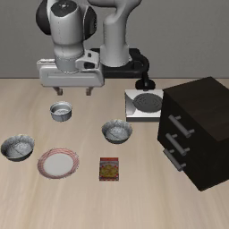

# HarnessVLA Frozen-Policy and Harness Reproduction

**LIBERO-Pro simulation research**

This project reproduces HarnessVLA in LIBERO-Pro by comparing direct calls to a frozen policy with harness-mediated execution. Paired ledgers, failure classification and memory ablations are used to investigate where the observed differences come from.

**Research question:** With the same frozen action policy, can an outer loop of observation, verification, retries and memory improve task execution?

**Current results:** Offline recomputation of the retained ledger, using complete condition pairs and excluding infrastructure failures, gives direct 15/40 and harness 23/40: 11 rescued pairs and 3 regressed pairs. These are existing records, not 80 new rollouts. [Analysis and limitations](docs/evidence/nov-m4/paired-analysis.json).

## Demos and Images

[](docs/evidence/oct-m3/video/A_harness_success_spatial_task.mp4)

[Watch the recorded clip](docs/evidence/oct-m3/video/A_harness_success_spatial_task.mp4). One successful LIBERO-Pro simulation example. The clip illustrates the task; it does not replace paired statistics and is not a B601 hardware demonstration.

## Work

The work covers reproduction, implementation, integration and analysis. Methods introduced in upstream ASPIRE / HarnessVLA papers remain credited to their authors. Shared code history and documentation updates are not counted as new implementation.

| Work | Details | Inspect |
|---|---|---|
| Direct-policy and harness execution | Hold the policy fixed while comparing outer-loop planning, verification, retries and memory. | [Code / evidence](track/launchers/run_harness.py) |
| Paired ledgers and failure classification | Record conditions, seeds and termination reasons to avoid mixing invalid or unpaired runs. | [Code / evidence](track/analysis/build_ledger.py) |
| Controlled and ablation analysis | Report overall improvement alongside local regressions, memory contamination and audit limits. | [Code / evidence](track/analysis/compare.py) |
| Auditable videos and experiment records | Index successful, regressed, ablation and clock-budget examples with their sources. | [Code / evidence](docs/evidence/nov-m4/video-index.csv) |

Follow the [implementation-to-evidence mapping](docs/evidence/oct-m3/implementation-commits.csv) to inspect actual implementation commits separately from documentation and evidence-packaging commits.

## Milestones and Status

| Stage | Technical evidence | Scope |
|---|---|---|
| Foundation and interface preparation | Code navigation below; [historical technical guide](docs/history/readme-before-showcase-2026-11-14.md) | Simulation, software checks and physical trials are identified separately |
| October / M3 integration | [Implementation and verification index](docs/evidence/oct-m3/README.md) | Inspectable implementation and listed tests; not a claim that all contractual items have been accepted |
| November / M4 comparison | [Comparison and demonstration index](docs/evidence/nov-m4/README.md) | Existing results and failure analysis; wireless comparisons and two industrial demonstrations remain incomplete |
| December / M5 preparation | [Reproduction, archive and follow-up work](docs/evidence/dec-m5/README.md) | Preparation / partial evidence; full clean-machine reconstruction, final demonstration and large-file retrieval remain outstanding |

Months label delivery stages; original records give experiment dates. Evidence packaging and no-hardware checks on 2026-11-14 do not imply new physical or simulated experiments on that date. See the [reading guide](docs/portfolio/README.md) for details.

## Limitations and Next Steps

These are simulation results, not evidence of physical B601 performance, wireless comparisons or industrial deployment. Ledger stages use different denominators: the earlier 5/20 versus 11/20 must not be combined with the expanded 15/40 versus 23/40 as a single experiment.

## Code Navigation and Verification

For the complete guide and evidence map, see the [documentation index](docs/README.md).

| Path | Contents |
|---|---|
| `track/launchers/` | Direct, harness and ablation entry points |
| `track/analysis/` | Ledgers, statistics and condition checks |
| `track/registry/` | Progress, risks, memory audits and frozen states |
| `docs/evidence/` | Ledger snapshots, videos and reproduction limits |

The following is a software-check entry point for an existing configured environment. Follow the [reproduction notes](docs/evidence/dec-m5/reproduce.md) for exact dependencies and platform requirements. This documentation update did not rerun the full experiments and does not require reviewers to move a physical arm.

```sh
python3 -m pytest track/tests/ -q
```

## Related Projects

| Project | Research / verification environment |
|---|---|
| [ASPIRE Skill Accumulation Reproduction](https://github.com/23garyd/aspire-sim-reproduction) | Simulation research |
| [ASPIRE Adapter for reBot B601](https://github.com/23garyd/aspire-robot-B601) | Software adaptation and fake-driver verification |
| [HarnessVLA Frozen-Policy and Harness Reproduction](https://github.com/23garyd/harnessvla-sim-reproduction) | LIBERO-Pro simulation research |
| [HarnessVLA Experiments on reBot B601](https://github.com/23garyd/harnessvla-rebot-b601) | Physical B601 research and engineering validation |

These are related but distinct reproduction and engineering projects. Results are reported separately. See the repository citations and license notices for upstream attribution.
