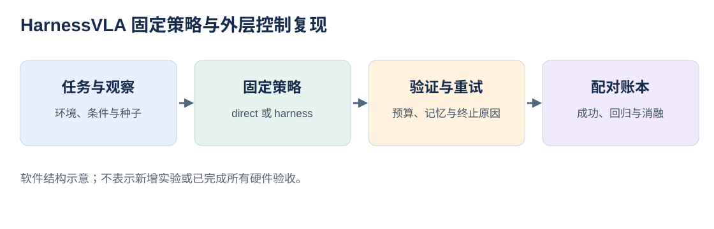

# HarnessVLA Frozen-Policy and Harness Reproduction — Reading Guide

This guide connects the research question, implementation, evidence and limitations. See the [project overview](../../README.md) for demos and a summary.

## Current Scope

This project reproduces HarnessVLA in LIBERO-Pro by comparing direct calls to a frozen policy with harness-mediated execution. Paired ledgers, failure classification and memory ablations are used to investigate where the observed differences come from.

Offline recomputation of the retained ledger, using complete condition pairs and excluding infrastructure failures, gives direct 15/40 and harness 23/40: 11 rescued pairs and 3 regressed pairs. These are existing records, not 80 new rollouts.

These are simulation results, not evidence of physical B601 performance, wireless comparisons or industrial deployment. Ledger stages use different denominators: the earlier 5/20 versus 11/20 must not be combined with the expanded 15/40 versus 23/40 as a single experiment.

## Software Architecture

The diagram explains code boundaries. Claims about execution and measured behavior remain limited to the evidence described below.

## Work and Attribution

This project reproduces existing research and provides engineering implementation, experiments and analysis. Upstream paper methods remain attributed to their authors. The [implementation commit map](../evidence/oct-m3/implementation-commits.csv) separates code contributions from evidence packaging. The two ASPIRE repositories share history; identical files or simulation clips are not counted as separate achievements. This documentation update adds reading guidance and media entry points, with no new training, rollouts or robot actions.

## Evidence Levels

| Evidence | Supports | Does not establish |
|---|---|---|
| Source code and no-hardware tests | Interfaces, control logic, error handling and some boundaries | Physical arm motion, real calibration or physical safety |
| Simulation results and videos | Behavior in the specified simulated environment, conditions and examples | Physical B601 performance or industrial deployment |
| Hardware results, video and telemetry | The shown physical trial and its recorded outcome | Other pipelines, other tasks or unmeasured wireless performance |
| Pinned commits and hashes | Traceable source files and auditable packaged versions | Experiment timing, task success or final contractual acceptance |

See [media-provenance.json](media-provenance.json) for sources. Where present, preview images are frames extracted directly at 1 second from existing videos; generated imagery does not replace experimental footage. Architecture diagrams are explanatory illustrations, not execution evidence.

## Stages and Evidence

[October / M3](../evidence/oct-m3/README.md), [November / M4](../evidence/nov-m4/README.md) and [December / M5](../evidence/dec-m5/README.md) retain their technical scope and outstanding items. Original experiment dates are not reassigned to delivery months.

Repository access permissions are unchanged. Technical pages do not contain invoices, commercial contracts or payment information.
